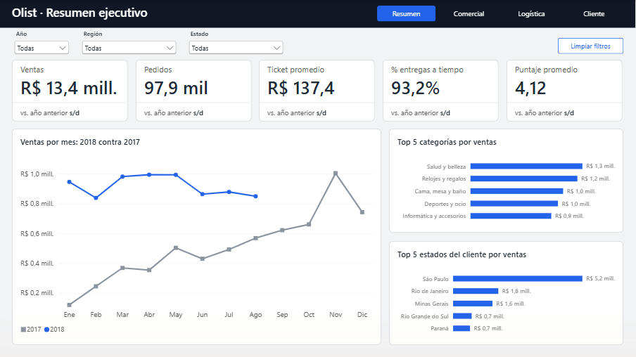
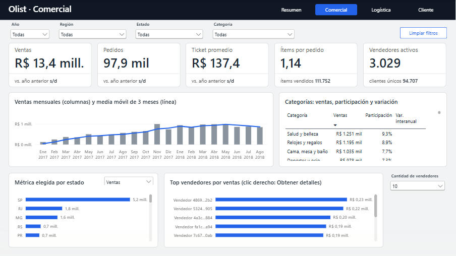
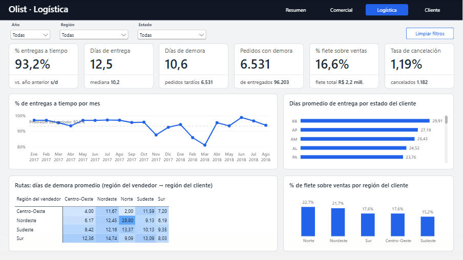
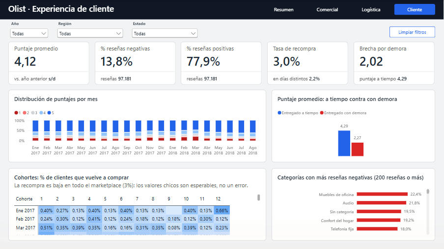
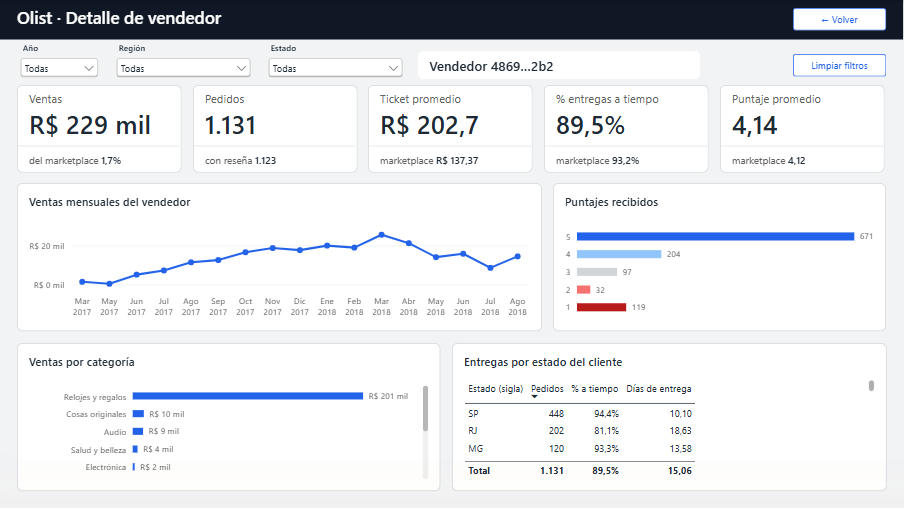
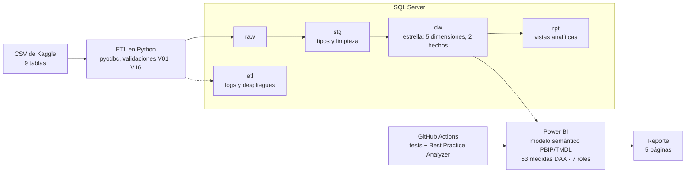

# Olist BI: del dato crudo al tablero

Solución de Business Intelligence completa sobre el e-commerce brasileño Olist: unos 100 mil pedidos reales (2016–2018) en 9 tablas relacionadas. Va desde los CSV hasta un tablero de Power BI con seguridad por región, con cada paso automatizado, validado y documentado.

**Stack:** Python (ETL y validación) · SQL Server (modelo dimensional) · Power BI (modelo semántico, DAX, seguridad por fila) · GitHub Actions (CI)

**Estado:** versión 1.0.0, las 12 fases del [roadmap](docs/roadmap.md) terminadas. Cambios por versión en el [CHANGELOG](CHANGELOG.md).



## Qué muestra

Tres áreas del negocio, cada una con sus preguntas ([requerimientos](docs/01_requerimientos.md)), y una página de detalle por vendedor:

| Página | Para quién | Responde |
|---|---|---|
| Resumen ejecutivo | Dirección | Ventas, pedidos, ticket, entregas a tiempo y puntaje, contra el año anterior |
| Comercial | Dirección comercial | Categorías, estados y vendedores que más venden; métrica y Top N elegibles |
| Logística | Logística | Entregas a tiempo por mes, días por estado, rutas con más demora, flete |
| Cliente | Experiencia de cliente | Reseñas, efecto de la demora en el puntaje, retención por cohorte |
| Detalle de vendedor | Comercial | Todo lo anterior para un vendedor, por obtención de detalles |

| | |
|---|---|
|  |  |
|  |  |

## Hallazgos

Período de análisis: enero de 2017 a agosto de 2018.

- **El negocio creció un 138%** en ventas de enero a agosto de 2018 contra el mismo período de 2017: en plena expansión. En todo el período, R$ 13,4 millones y 97.905 pedidos.
- **La demora es lo que más castiga la reseña.** Un pedido que llega tarde tiene un puntaje promedio de 2,3, contra 4,3 si llega a tiempo, y el 62% de las reseñas de los pedidos tardíos son negativas (9% en los que llegan a tiempo). Solo el 6,8% de los pedidos entregados llega tarde, pero de ahí sale un tercio de todas las reseñas negativas.
- **Las entregas a tiempo cayeron a 81% en marzo de 2018** y a 86% en febrero, contra un 93% del período. Noviembre de 2017, el mes del Black Friday, también quedó por debajo (88%).
- **La geografía pesa:** un pedido a Roraima tarda 30 días en promedio; uno a São Paulo, 9. Las rutas hacia el Norte y el Nordeste concentran la demora.
- **Casi nadie vuelve a comprar.** La recompra es del 3,0%, y casi un tercio de esa recompra es el mismo carrito partido en dos pedidos el mismo día: contando días distintos, baja a 2,2% ([04_optimizacion_sql.md](docs/04_optimizacion_sql.md)). Es el punto más débil del negocio, más que la logística.
- **Un error de datos que habría pasado inadvertido:** unir ítems con pagos infla las ventas un 4,5%, porque un pedido puede tener varios pagos. Por eso los dos hechos tienen distinta granularidad y no se unen ([02_calidad_datos.md](docs/02_calidad_datos.md), Q12).

## Arquitectura



**Decisiones principales** (todas en el [registro de decisiones](docs/decisiones.md), con lo que se descartó):

- **Dos tablas de hechos con distinta granularidad** (ítem y pedido), sin relación entre sí. El vendedor se cruza con la entrega en DAX, con `TREATAS` (D-014).
- **Las reglas de negocio se calculan una vez, en SQL** (válido, entregado, a tiempo, meses desde la primera compra), y el DAX las usa como columnas (D-016, D-020).
- **Seguridad por fila dinámica:** un solo rol filtra por el correo de quien inicia sesión contra una tabla de gerentes y estados. Un gerente nuevo es una fila en SQL, no un cambio en el modelo (D-022).
- **Rendimiento medido, no supuesto:** índices elegidos midiendo 5 estrategias (D-017). El modelo pasó de 33,7 a 9,9 MB, y ningún visual tarda más de 2 s (D-023).

## Calidad y verificación

- **16 validaciones automáticas en el ETL.** Si falla una crítica, la carga se corta y la base queda como estaba.
- **Los KPIs se calculan dos veces, por caminos independientes,** y tienen que coincidir: Python sobre los CSV (`src/kpi_reference.py`) contra SQL (tests de integración) y contra DAX (`Control KPIs.dax`, 47 controles).
- **114 tests.** En el CI corren los que no necesitan base: el modelo semántico (relaciones, roles, formatos, rendimiento), el ETL y el despliegue. Además, el Best Practice Analyzer revisa el modelo en cada pull request.
- **Prueba de usabilidad con otra persona:** 4 de 4 preguntas respondidas ([07_diseno_reportes.md](docs/07_diseno_reportes.md)).

## Cómo ejecutarlo

Requisitos: Python 3.12, SQL Server (Express alcanza), ODBC Driver 18 for SQL Server y Power BI Desktop.

```bash
python -m venv .venv
.venv\Scripts\activate
pip install -r requirements.txt

python -m src.setup.extract_data "ruta/al/archive.zip"   # datos: ver data/README.md
python -m src.setup.create_database                      # base OlistDW, esquemas y tablas de log
python -m src.setup.check_environment                    # verifica que todo esté listo
python -m src.etl.run                                    # ETL: CSV -> raw -> stg -> dw -> rpt, con validaciones
pytest
```

Después, abrir `powerbi/olist.pbip` en Power BI Desktop y actualizar.

**Despliegue a los entornos** de desarrollo y producción ([10_despliegue.md](docs/10_despliegue.md)):

```bash
python -m src.despliegue dev     # OlistDW_dev
python -m src.despliegue prod    # OlistDW_prod: solo desde main y con el commit ya probado en dev
```

Para usar otro servidor u otra base: variables de entorno `OLIST_SQL_SERVER`, `OLIST_SQL_DATABASE` y `OLIST_SQL_DRIVER` (ver `src/config.py`). En Power BI, los parámetros `Servidor` y `BaseDatos`.

## Estructura

```
data/raw/        CSV de Olist (no versionados)
src/setup/       preparación del entorno
src/etl/         pipeline de extracción, limpieza, carga y validación
src/despliegue.py, src/bpa.py   despliegue a dev/prod y control del Best Practice Analyzer
sql/00_setup ... un directorio por capa: setup, raw, stg, dw, vistas rpt
notebooks/       perfilado de los datos
powerbi/         proyecto Power BI (PBIP: modelo en TMDL y reporte en JSON, versionables)
docs/            requerimientos, KPIs, modelo, decisiones, capturas
tests/           tests (corren en el CI)
```

## Documentación

| Fase | Documento |
|---|---|
| Plan | [Roadmap](docs/roadmap.md) · [Registro de decisiones](docs/decisiones.md) · [Riesgos y bloqueos](docs/riesgos.md) |
| 1. Requerimientos | [Requerimientos de negocio](docs/01_requerimientos.md) · [Diccionario de KPIs](docs/kpi_diccionario.md) · [Bocetos](docs/bocetos/) |
| 2. Perfilado | [Calidad de datos](docs/02_calidad_datos.md) · [Notebook](notebooks/02_perfilado.ipynb) |
| 3. ETL | [ETL](docs/etl.md) · [Datos: origen y tablas](data/README.md) |
| 4–5. SQL | [Modelo dimensional](docs/03_modelo_dimensional.md) · [SQL analítico y optimización](docs/04_optimizacion_sql.md) |
| 6–7. Power BI | [Modelo semántico](docs/05_modelo_semantico.md) · [Medidas DAX](docs/06_dax.md) |
| 8. Reportes | [Diseño de reportes](docs/07_diseno_reportes.md) · [Capturas](docs/capturas/) |
| 9. Seguridad | [Seguridad a nivel de fila](docs/08_seguridad_rls.md) |
| 10. Rendimiento | [Rendimiento del modelo](docs/09_rendimiento.md) |
| 11. Despliegue | [Versionado y despliegue](docs/10_despliegue.md) |

## Datos

[Brazilian E-Commerce Public Dataset by Olist](https://www.kaggle.com/datasets/olistbr/brazilian-ecommerce), publicado en Kaggle bajo licencia CC BY-NC-SA 4.0. Los CSV no se versionan: [data/README.md](data/README.md) explica cómo obtenerlos.
