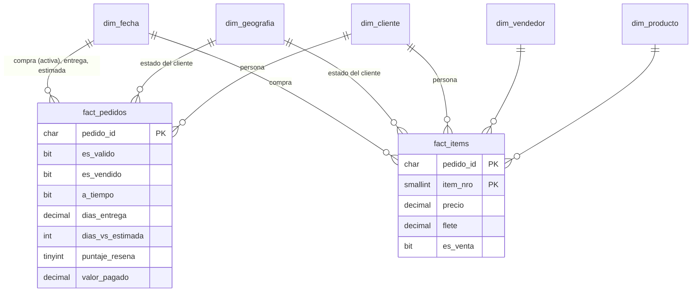

# Modelo dimensional

**Fase:** 4 · **SQL:** [sql/03_dw/](../sql/03_dw/) · **Se carga con:** `python -m src.etl.run` (pasos 5 y 6)

Modelo en estrella en el esquema `dw`, que es lo que lee Power BI. Dos tablas de hechos con distinta granularidad comparten cinco dimensiones.

## Diagrama



Las dos tablas de hechos **no se relacionan entre sí** (ver la sección "Cruzar vendedores con entregas").

## Matriz de bus

Qué dimensiones usa cada hecho. Una dimensión compartida filtra a los dos hechos a la vez: si el usuario elige "Nordeste", ventas y entregas muestran lo mismo.

| | `dim_fecha` | `dim_geografia` | `dim_cliente` | `dim_vendedor` | `dim_producto` |
|---|:-:|:-:|:-:|:-:|:-:|
| **`fact_pedidos`** | ✔ compra, entrega, estimada | ✔ | ✔ | — | — |
| **`fact_items`** | ✔ compra | ✔ | ✔ | ✔ | ✔ |

## Tablas

### Hechos

| Tabla | Granularidad | Filas | Para qué |
|---|---|---|---|
| `fact_items` | Un ítem vendido | 112.650 | Ventas, flete, ítems, todo lo que se analiza por producto o vendedor (Comercial) |
| `fact_pedidos` | Un pedido | 99.441 | Entregas, demoras, reseñas, pagos, recompra (Logística y Cliente) |

**Por qué dos y no una:** un pedido tiene varios ítems y varios pagos. En una sola tabla a nivel ítem, los datos del pedido (días de entrega, puntaje de la reseña) se repetirían por cada ítem, y los promedios le darían más peso a los pedidos con más ítems. A nivel pedido se pierde el producto y el vendedor. La Fase 2 midió el costo de mezclar granularidades: unir ítems con pagos infla las ventas un 4,5% (Q12).

**Reglas de negocio como columnas** ([D-016](decisiones.md#d-016--las-reglas-de-negocio-se-calculan-una-vez-en-sql)): `fact_pedidos` trae calculadas las reglas del diccionario de KPIs, para que el DAX no las repita:

| Columna | Regla | Usada en |
|---|---|---|
| `es_valido` | R1: no cancelado ni sin stock | K06, K25 y como filtro general |
| `es_vendido` | R1 + R8: válido y con ítems | K02 |
| `es_entregado` | Estado entregado y con fecha de entrega | K16 a K20 |
| `a_tiempo` | R3: entrega (sin hora) ≤ estimada; vacío si no se entregó | K17, K20, K26 |
| `dias_entrega` | Compra → entrega, con decimales | K18 |
| `dias_vs_estimada` | Entrega − estimada; positivo = tarde | K19 |
| `puntaje_resena` | R7: la última reseña respondida | K22 a K24, K26 |

`fact_items.es_venta` repite la regla R1 del pedido, así las ventas se filtran sin cruzar las dos tablas.

### Dimensiones

| Tabla | Granularidad | Filas | Notas |
|---|---|---|---|
| `dim_fecha` | Un día, 2016-01-01 a 2018-12-31 | 1.096 | Continua (sin huecos), con nombres en español y `en_periodo_analisis` (D-008). Clave `AAAAMMDD`. |
| `dim_geografia` | Un estado | 27 + 1 | Estado del **cliente** al momento del pedido, con su región. Es la que filtra la seguridad por fila (Fase 9). |
| `dim_cliente` | Una persona (`customer_unique_id`) | 96.096 + 1 | Fecha de primera compra y cohorte, sobre todo el historial. Sin ubicación ([D-015](decisiones.md#d-015--el-cliente-es-la-persona-y-la-ubicación-es-la-del-pedido)). |
| `dim_vendedor` | Un vendedor | 3.095 + 1 | Con su estado y región desnormalizados, para la matriz de rutas (L3) sin otra tabla. |
| `dim_producto` | Un producto | 32.951 + 1 | Categoría en español; "Sin categoría" para los 610 sin dato (Q17). |

El "+ 1" es el **miembro Desconocido** (clave −1): si un hecho no encuentra su dimensión, apunta ahí en vez de perderse en una unión. Con los datos actuales ningún hecho lo usa (validación V15), pero si el origen cambiara, los totales seguirían cerrando y la advertencia lo mostraría.

## Relaciones para Power BI (Fase 6)

| Desde | Hacia | Cardinalidad | Filtro | Activa |
|---|---|---|---|---|
| `dim_fecha[fecha_key]` | `fact_pedidos[fecha_compra_key]` | 1 : N | Una dirección | ✔ |
| `dim_fecha[fecha_key]` | `fact_pedidos[fecha_entrega_key]` | 1 : N | Una dirección | ✘ (USERELATIONSHIP) |
| `dim_fecha[fecha_key]` | `fact_pedidos[fecha_estimada_key]` | 1 : N | Una dirección | ✘ (USERELATIONSHIP) |
| `dim_fecha[fecha_key]` | `fact_items[fecha_compra_key]` | 1 : N | Una dirección | ✔ |
| `dim_geografia`, `dim_cliente` | los dos hechos | 1 : N | Una dirección | ✔ |
| `dim_vendedor`, `dim_producto` | `fact_items` | 1 : N | Una dirección | ✔ |

- **Todas uno a muchos y en una sola dirección.** El filtro bidireccional genera ambigüedad cuando hay más de un camino entre dos tablas y es más lento; acá no hace falta.
- **Fecha con tres roles en `fact_pedidos`:** compra, entrega y estimada. Solo puede haber una relación activa entre dos tablas, así que la de compra es la activa (regla R6: todo se ubica por fecha de compra) y las otras dos se activan dentro de una medida con `USERELATIONSHIP` cuando haga falta (por ejemplo, "pedidos entregados en marzo").
- **Las claves de fecha vacías** (pedidos no entregados) quedan en blanco y no rompen la relación. Por eso `dim_fecha` no tiene miembro −1: Power BI exige que la tabla de fechas no tenga fechas vacías.

## Cruzar vendedores con entregas

**El problema:** la página de detalle de vendedor muestra su % de entregas a tiempo (K17), pero la entrega es por pedido (`fact_pedidos`) y el vendedor es por ítem (`fact_items`). El 1,3% de los pedidos tiene más de un vendedor (Q13).

**La solución ([D-014](decisiones.md#d-014--dos-tablas-de-hechos-y-treatas-para-cruzarlas)):** en DAX, tomar los pedidos del vendedor desde `fact_items` y aplicarlos como filtro sobre `fact_pedidos`, sin relación física:

```dax
% a tiempo (por vendedor) =
CALCULATE (
    [% entregas a tiempo],
    TREATAS ( VALUES ( fact_items[pedido_id] ), fact_pedidos[pedido_id] )
)
```

Así un pedido con dos vendedores cuenta para cada uno (la decisión de Q13), y el total del marketplace sigue contando cada pedido una sola vez. Lo mismo sirve para la matriz de rutas (L3) y las reseñas por categoría (X3).

## Cómo se verifica

- **En cada carga** (validaciones de `dw`): un hecho por pedido y uno por ítem, ventas y flete iguales a `raw` al centavo, y ningún hecho en el miembro Desconocido.
- **Contra el diccionario** (`tests/test_integracion_sql.py`): 13 KPIs calculados sobre `dw`, con las columnas de reglas y el período de `dim_fecha`, coinciden con los valores de referencia que calcula Python sobre los CSV.
