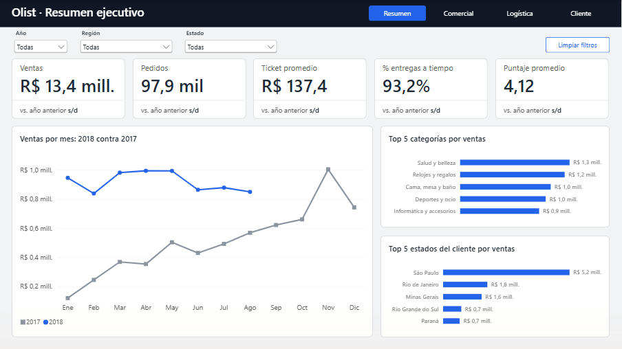
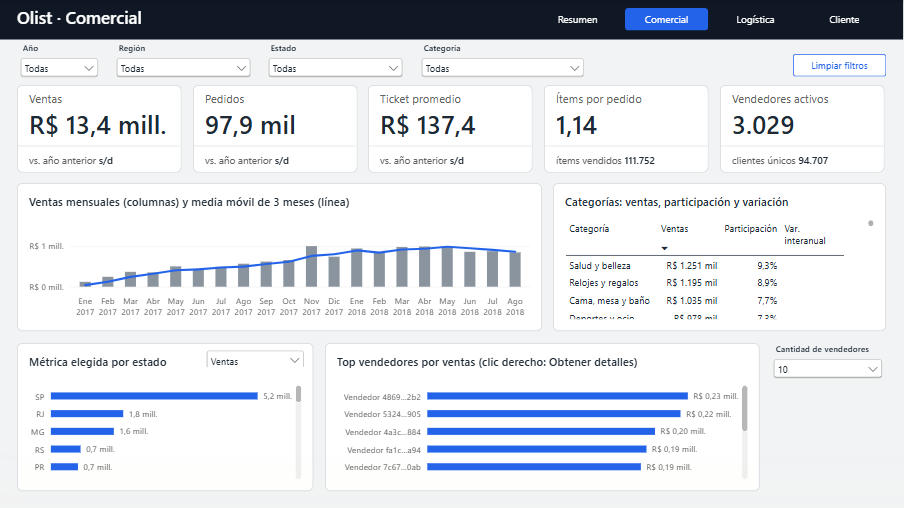
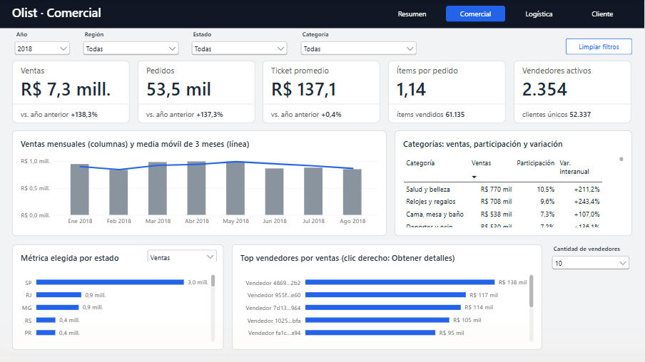
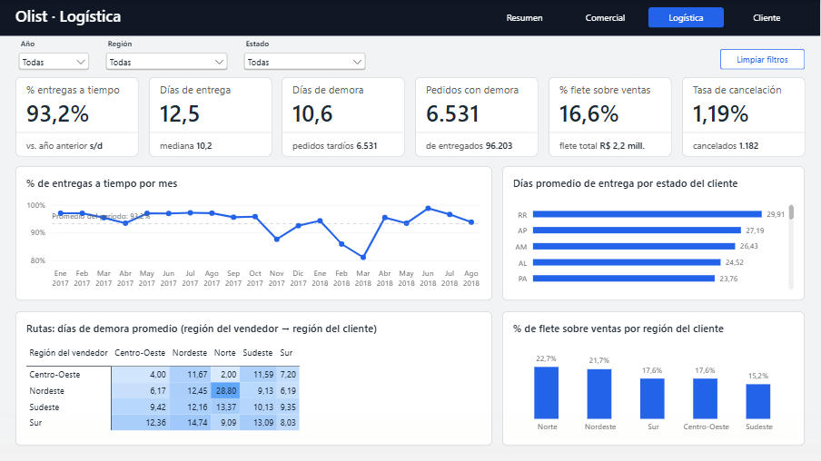
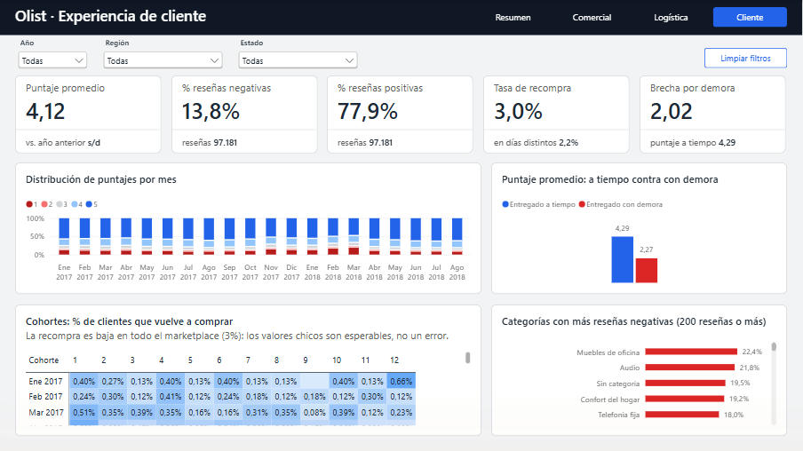
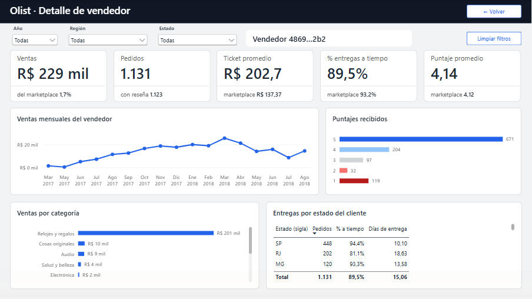

# Criterios de diseño de los reportes

**Fase:** 8 · **Tema:** [powerbi/tema/olist.json](../powerbi/tema/olist.json) · **Bocetos:** [docs/bocetos/](bocetos/README.md)

Este documento fija las reglas con las que se arman las 5 páginas del tablero. Parte de los criterios que ya tenían los bocetos (Fase 1) y los contrasta con tres fuentes: la guía de diseño y la de accesibilidad de Microsoft para Power BI, y la regla 3-30-300 de SQLBI. Donde una fuente obligó a cambiar algo de los bocetos, está marcado con **Cambio**.

## 1. El contexto define las prioridades

| Factor | En este proyecto | Consecuencia de diseño |
|---|---|---|
| **Quién lo usa** | Dirección (semanal), Logística (diaria), CX (semanal), gerentes regionales | Una página por área, y el Resumen para Dirección. Cada página responde las preguntas de su área (C1–C5, L1–L5, X1–X5) y nada más. |
| **Para qué** | Detectar problemas y decidir dónde actuar | Lo que pide acción se resalta; lo normal queda en gris. |
| **Dónde se mira** | Pantalla de escritorio, Power BI Desktop | Lienzo 16:9 de 1280 × 720, sin scroll. |
| **Para qué más** | Portfolio y entrevistas | Cada decisión tiene que poder explicarse: está escrita acá, con su fuente. |

La guía de Microsoft lo resume en una pregunta: qué métricas ayudan a la audiencia a decidir. El objetivo, como dice SQLBI, es un reporte **útil** antes que lindo.

## 2. Jerarquía: la regla 3-30-300

Cada página se organiza en tres niveles de lectura (SQLBI). Los tiempos son orientativos, no metas literales:

| Nivel | Pregunta del usuario | Qué va | Dónde |
|---|---|---|---|
| **3 segundos** | ¿Cómo estamos? | Tarjetas de KPI con su variación | Arriba, de izquierda a derecha |
| **30 segundos** | ¿Dónde está el problema? | Evolución mensual y rankings por categoría, región o vendedor | El cuerpo de la página |
| **300 segundos** | ¿Qué hago con esto? | Matrices de detalle, tooltips y la página de detalle de vendedor | Abajo, y en la página de obtención de detalles |

Esto ya lo seguían los bocetos ("de lo general a lo particular"). SQLBI agrega una regla que los bocetos no tenían, y que se adopta:

- **Cambio:** la esquina superior izquierda es para el número más importante, nunca para filtros, logos o botones. En los bocetos, la barra de filtros empezaba arriba a la izquierda. Pasa a una fila propia **debajo del encabezado**, con el título de la página a la izquierda y la navegación a la derecha, de modo que la primera tarjeta de KPI siga siendo lo primero que se lee después del título.

## 3. Estructura y grilla

Se mantiene la de los bocetos, porque coincide con la guía de Microsoft: una página por pantalla, sin barras de desplazamiento.

- Lienzo de **1280 × 720**, márgenes de **24 px** y **16 px** entre visuales, con los bordes de las tarjetas alineados entre filas. Power BI propone hoy 1920 × 1080 por defecto (también 16:9); se usa 1280 × 720 porque los tamaños de letra del tema están pensados para esa escala, y se configura en cada página.
- Mismo esqueleto en todas las páginas: encabezado con navegación, fila de filtros, fila de KPIs y dos filas de visuales.
- **Entre 4 y 6 visuales por página, además de los KPIs.** Microsoft lo recomienda por legibilidad y también por rendimiento: cada visual es al menos una consulta.
- **Los filtros van en el mismo lugar y orden en todas las páginas** (Año, Región, Estado) y están sincronizados entre páginas. Microsoft lo exige en su lista de accesibilidad: cambiar de lugar los controles obliga a buscarlos de nuevo.

## 4. Elección de gráficos

| Pregunta | Gráfico | Por qué |
|---|---|---|
| ¿Cuánto? (un número) | Tarjeta, con variación "vs. año anterior" cuando es comparable (D-021) | Lo más importante, lo más grande (Microsoft) |
| ¿Cómo evoluciona? | Líneas; columnas si son volúmenes mensuales | El tiempo siempre en el eje horizontal |
| ¿Contra el año anterior? | Línea actual sólida y azul; año anterior gris | Notación habitual de reportes de negocio (IBCS): actual oscuro, comparación clara |
| ¿Quién es el mayor? | Barras horizontales ordenadas | Microsoft: las barras comparan mejor que las tortas |
| ¿Cómo se compone en el tiempo? | Columnas apiladas al 100% | Puntajes de 1 a 5 por mes |
| ¿Dos dimensiones a la vez? | Matriz con color de fondo y el valor escrito | Rutas y cohortes |

**Se descartan:** tortas, anillos y medidores (Microsoft: el ojo compara mal los ángulos), gráficos 3D y ejes que no empiezan en 0 en barras.

- **Cambio, el mapa:** el mapa coroplético de Power BI usaba Bing Maps, que Microsoft está dando de baja en favor de Azure Maps. Además, un mapa compara peor que un ranking: Amazonas es enorme y tiene el 0,2% de las ventas. Por eso la geografía se muestra como **ranking de barras por estado**, y el mapa con Azure Maps queda como complemento opcional en la página Comercial, si funciona en el equipo.
- **Cambio, la matriz de rutas:** en el boceto era estado × estado (hasta 27 × 27 combinaciones, la mayoría con menos de 30 pedidos y por lo tanto vacías). Pasa a **región del vendedor × región del cliente**: 5 × 5, todas con datos suficientes, y se lee de un vistazo. El detalle por estado queda en el tooltip.

## 5. Color

Un solo color de marca y un color de alerta. **El color señala; no decora.** Cada color se midió contra los criterios de WCAG 2.1 que cita Microsoft (texto: al menos 4,5:1; elementos gráficos: al menos 3:1) y se simuló cómo lo ve una persona con deuteranopía y con protanopía, los dos daltonismos más comunes. Script de medición: método de Machado (2009), diferencia de color ΔE en CIELAB.

| Rol | Color | Contraste sobre blanco | Uso |
|---|---|---:|---|
| Actual, lo que hay que mirar | Azul `#2563EB` | 5,17:1 | Serie principal, primero del ranking, elemento seleccionado |
| Comparación, lo normal | Gris `#8B93A0` | 3,10:1 | Año anterior, resto del ranking |
| Alerta | Rojo `#DC2626` | 4,83:1 | Solo lo que pide acción: demoras, reseñas negativas, por debajo del promedio |
| Texto principal | `#1F2937` | 14,68:1 | Valores, títulos |
| Texto secundario | `#4B5563` | 7,56:1 | Etiquetas, ejes |
| Escala secuencial | `#DBEAFE` → `#60A5FA` | — | Mapas de calor: claro = menos |

**Lo que dejaron las mediciones:**
- **Cambio:** el gris de los bocetos (`#9CA3AF`) tenía 2,54:1 y no llegaba al 3:1 que se pide para elementos gráficos. Se oscureció a `#8B93A0`.
- **Azul y gris se mantienen**, aunque Microsoft lista "azul y gris" entre las combinaciones difíciles: en este par la diferencia es de ΔE 64 aun simulando protanopía (a partir de ~10 ya se nota). Lo que los separa es el brillo, no el tono, y el brillo no se pierde con el daltonismo.
- **No se usa verde para "bien".** Rojo y verde es la combinación más problemática. "Bien" es azul o simplemente neutro, y la dirección se marca además con **▲ / ▼**.
- **El texto va sobre las tarjetas blancas o sobre el encabezado oscuro.** El texto secundario directo sobre el gris de la página (`#F3F4F6`) baja a 4,39:1.
- **Cambio, la escala de los mapas de calor termina en `#60A5FA` y no en `#1E3A8A`:** con el azul más oscuro, el valor escrito en texto oscuro deja de leerse en las celdas más altas, justo las que importan.
- **En los mapas de calor, el valor va escrito en la celda.** Los tonos claros de la escala no llegan a 3:1 contra el blanco: el color ayuda, pero nunca es el único dato (regla de accesibilidad de Microsoft).

Todo esto está en el tema [powerbi/tema/olist.json](../powerbi/tema/olist.json): Power BI lo aplica solo a cada visual nuevo.

## 6. Texto y números

- **Fuente Segoe UI**, la de Power BI. Valores de KPI en 27 pt (28 no entraba en una tarjeta de 233 px de ancho con "R$ 13,4 mill."), títulos en 12 pt, etiquetas en 10 pt.
- **Títulos que dicen qué se mira**, sin siglas ni jerga (Microsoft): "Días promedio de entrega por estado del cliente", no "K18 por UF".
- **Números abreviados:** R$ 13,4 M, no 13.449.529,68 (Microsoft: no más de 3 o 4 cifras). El valor exacto va en el tooltip.
- **No mezclar escalas ni períodos** en un mismo visual (Microsoft).
- **Etiquetas de datos solo cuando agregan algo.** En barras ordenadas, el valor al final de la barra; en líneas, ninguna: el eje y el tooltip alcanzan, y 20 etiquetas tapaban la línea.
- **Orden pensado:** rankings ordenados por el valor; meses, por calendario.
- **Líneas rectas entre meses**, nunca suavizadas (en el tema). La curva suavizada dibujaba valores que ningún mes tuvo: entre noviembre y diciembre de 2017 pasaba por encima del pico de Black Friday.
- **Las series mensuales ocupan 744 px de ancho** en todas las páginas. Con 600 px, las 20 etiquetas de mes se giraban y le quitaban al gráfico casi la mitad del alto.
- **Cuando un filtro deja un gráfico vacío, el título lo explica.** Las categorías con más reseñas negativas exigen 200 reseñas; con un estado chico ninguna llega, y el título pasa a decir eso en lugar de mostrar un recuadro en blanco (medida `Título reseñas negativas por categoría`).

## 7. Interacción

- **Cambio, sin filtro de "Estado del vendedor" en Logística:** por el mismo motivo, los KPIs por pedido no responden al vendedor. La matriz de rutas muestra esa dimensión.
- **Cambio, el filtro de categoría va solo en Comercial:** la categoría es de cada ítem, y `% entregas a tiempo` y `Puntaje` son por pedido (D-014). En las otras páginas esas tarjetas no cambiarían al filtrar, sin ningún aviso.
- **Botones de navegación propios** en el encabezado, en lugar de las pestañas de Power BI.
- **Obtención de detalles** (*drill-through*): clic derecho en un vendedor lleva a su página de detalle, que tiene un botón **← Volver**.
- **Filtros sincronizados entre páginas**, y un botón **Limpiar filtros**. **Cambio:** se hizo con la acción "Borrar todos los segmentadores" del botón y no con un marcador. Un marcador guarda el estado de toda la página y hay que rehacerlo cada vez que cambia un visual; la acción no depende del diseño. En Desktop, los botones se usan con Ctrl + clic.
- **Controles propios de un gráfico:** el selector de métrica (ventas, pedidos, ticket o flete por estado) y la cantidad de vendedores del Top N. No se sincronizan entre páginas, porque solo existen en Comercial.
- **Tooltips con el detalle**, pero nunca con información imprescindible: no se ven sin mouse ni los lee un lector de pantalla (Microsoft).
- **El período de análisis** (ene-2017 a ago-2018, D-008) va como **filtro de todo el reporte** sobre `En período de análisis`, no como un segmentador que alguien pueda olvidarse de tildar.

## 8. Accesibilidad: lista de control

Tomada de la lista de Microsoft, solo con lo que aplica a este reporte. Se revisa página por página al terminar la Fase 8.

- [x] Texto con contraste de 4,5:1 o más, y elementos gráficos con 3:1 o más (el tema ya lo cumple).
- [x] Ninguna información transmitida solo por el color: las variaciones llevan signo (+138,3 %, −0,45), los valores van escritos en los mapas de calor y en cada barra, y las dos series del gráfico de líneas tienen marcador distinto. Se usa el signo y no ▲ / ▼ porque lo da el formato de la medida y dice lo mismo.
- [x] **Texto alternativo** en los 46 visuales que transmiten información (gráficos, tablas y tarjetas). El fondo del encabezado es decorativo y está fuera del orden de tabulación.
- [x] **Orden de tabulación** igual al orden de lectura en las 5 páginas: título, navegación, filtros, KPIs de izquierda a derecha y después el cuerpo, de arriba hacia abajo.
- [x] Marcadores de forma distinta en los gráficos de líneas con más de una serie (2018 círculo, 2017 cuadrado).
- [ ] Prueba de los "ojos entrecerrados": si lo primero que se ve son las etiquetas y no los datos, sobran etiquetas. No se hizo por separado.
- [x] Prueba con otra persona: que responda preguntas de negocio usando el tablero, y anotar dónde se traba (roadmap, Fase 8). Guion y resultados en la sección 11.

## 9. Qué se agrega al modelo para estas páginas

Al bajar los bocetos a visuales concretos aparecen faltantes en el modelo semántico. Se agregan al construir cada página:

| Para | Falta | Solución |
|---|---|---|
| Distribución de puntajes (X1) | Una columna para usar los puntajes 1 a 5 como categoría | Mostrar `puntaje_resena` como columna visible `Puntaje de reseña` |
| Distribución de puntajes y filtro de categorías con 200 reseñas o más (X3) | Contar reseñas | Medidas `Reseñas` y `Reseñas (por ítems)` |
| Puntaje a tiempo contra tarde (X2) | Los dos valores por separado (hoy solo existe la brecha) | Medidas `Puntaje a tiempo` y `Puntaje con demora` |
| Detalle de vendedor | Comparar contra todo el marketplace | Medidas `Participación en el marketplace`, `Ticket del marketplace` y `Vendedor elegido`. Para el % a tiempo y el puntaje no hace falta: `% entregas a tiempo` y `Puntaje promedio de reseña` ignoran el filtro de vendedor |
| Tasa de cancelación (L5) | La cantidad de pedidos | Medida `Pedidos cancelados` |
| Categorías con más reseñas negativas (X3) | Un título que explique el gráfico vacío cuando ninguna categoría llega a 200 reseñas | Medida `Título reseñas negativas por categoría`, usada como título del gráfico |

## 10. Resultado

Las 5 páginas, con todos los años del período de análisis (capturas de Power BI Desktop, en [docs/capturas/](capturas/)).

**Resumen ejecutivo.** Una cifra por área y la evolución de las ventas contra el año anterior.

**Comercial.** El selector de métrica cambia el ranking de estados; el control de la derecha elige cuántos vendedores mostrar; clic derecho en un vendedor abre su detalle.

Con un año elegido aparecen las variaciones interanuales (D-021): 2018 contra el mismo período de 2017.

**Logística.** La línea punteada es el promedio del período; febrero y marzo de 2018 son los meses que piden explicación.

**Cliente.** El hallazgo central: con demora, el puntaje baja de 4,29 a 2,27.

**Detalle de vendedor.** El vendedor que más vende, al que se llega desde Comercial.

### Contra los criterios de aceptación de la Fase 1

El detalle está en [01_requerimientos.md](01_requerimientos.md#7-criterios-de-aceptación). Al cerrar la Fase 8 se cumplían todos menos tres:

- **% de flete por categoría (L4).** Logística muestra el flete por región. Por categoría no se ve, porque el filtro de categoría quedó solo en Comercial. Queda como pendiente.
- **Menos de 2 segundos por visual en Performance Analyzer.** No se midió todavía; la consulta más pesada medida con DAX Studio en la Fase 7 (rutas) tarda 407 ms. Se mide en la Fase 10.
- **Seguridad por región:** resuelta en la Fase 9 ([08_seguridad_rls.md](08_seguridad_rls.md)).

## 11. Prueba de usabilidad

Una persona que no conozca el tablero responde estas preguntas usándolo, sin ayuda. Se anota si llegó, cuánto tardó y dónde dudó. La prueba mide el tablero, no a la persona: si alguien se traba, el problema es del diseño.

| # | Pregunta | Respuesta esperada | Dónde está |
|---|---|---|---|
| 1 | ¿En qué mes de 2017 se vendió más, y cuánto? | Noviembre, cerca de R$ 1,0 mill. | Resumen |
| 2 | ¿Qué región de clientes paga más flete en proporción a lo que compra? | Norte, 22,7 % | Logística |
| 3 | ¿Cuánto baja el puntaje de reseña cuando un pedido llega tarde? | De 4,29 a 2,27: unos 2 puntos | Cliente |
| 4 | ¿El vendedor que más vende entrega a tiempo más o menos que el marketplace? | Menos: 89,5 % contra 93,2 % | Comercial → clic derecho → Detalle de vendedor |

**Resultados** (2026-11-25):

| # | ¿Llegó? | Tiempo | Dónde dudó |
|---|---|---|---|
| 1 | Sí | Menos de un minuto | — |
| 2 | Sí | Menos de un minuto | — |
| 3 | Sí | Menos de un minuto | — |
| 4 | Sí, con dificultad | Más que las otras | No entendía a qué se refería la pregunta |

Las tres preguntas que se responden mirando una página salieron sin dudas. La cuarta es la única que necesita pasar de una página a otra (clic derecho → Obtener detalles), y lo que costó fue entender la pregunta, no encontrar el dato. Para una próxima prueba conviene escribirla como tarea: "En Comercial, entrá al detalle del vendedor que más vende y compará su % de entregas a tiempo con el del marketplace".

## Fuentes

- Microsoft Learn, [Tips and tricks for creating reports in Power BI](https://learn.microsoft.com/en-us/power-bi/create-reports/desktop-tips-and-tricks-for-creating-reports): una página por pantalla, lo importante arriba a la izquierda y más grande, tortas y medidores con uso limitado, escalas y colores consistentes, números abreviados, Bing Maps en baja.
- Microsoft Learn, [Design Power BI reports for accessibility](https://learn.microsoft.com/en-us/power-bi/create-reports/desktop-accessibility-creating-reports): contraste de 4,5:1, combinaciones de color difíciles, texto alternativo, orden de tabulación, marcadores, tooltips, consistencia de los segmentadores.
- Microsoft Learn, [Optimization guide for Power BI](https://learn.microsoft.com/en-us/power-bi/guidance/power-bi-optimization): limitar los visuales por página y llevar el detalle a tooltips y páginas de obtención de detalles.
- SQLBI, [Introducing the 3-30-300 rule for better reports](https://www.sqlbi.com/articles/introducing-the-3-30-300-rule-for-better-reports/): jerarquía de lectura y lugar de los filtros.
- IBCS, [IBCS Standards](https://www.ibcs.com/resource/ibcs-standards-book/) e [ISO 24896](https://www.ibcs.com/iso-24896/): notación de reportes de negocio (actual frente a año anterior). Se toma solo la idea de actual oscuro y comparación clara, no la norma completa.
- W3C, WCAG 2.1, criterio 1.4.3 (contraste de texto, citado por Microsoft) y 1.4.11 (contraste de elementos gráficos).
