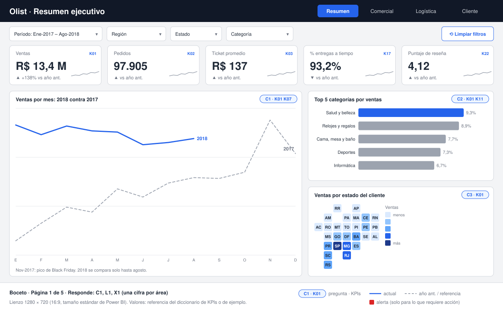
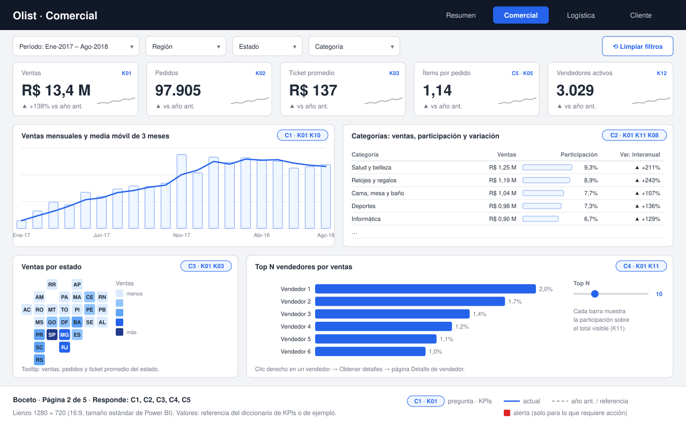
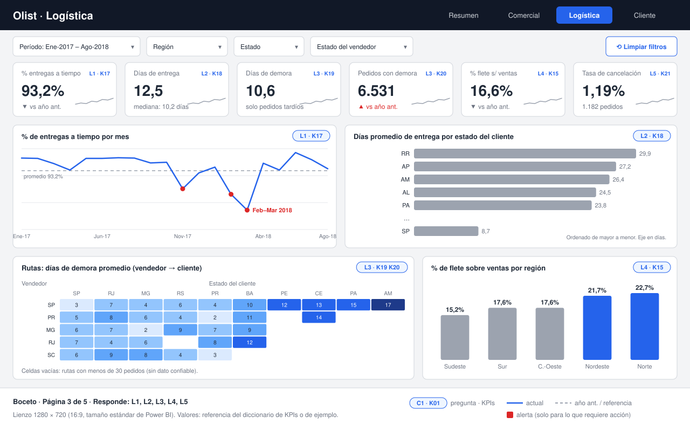
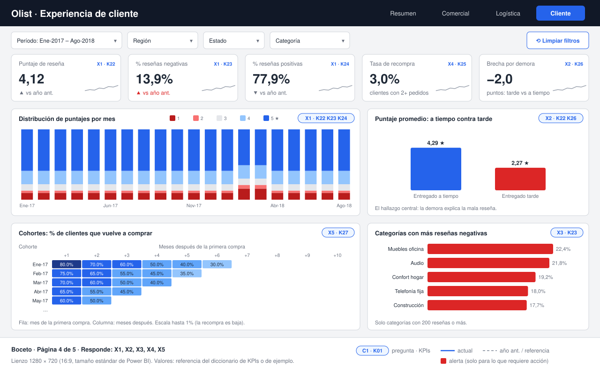
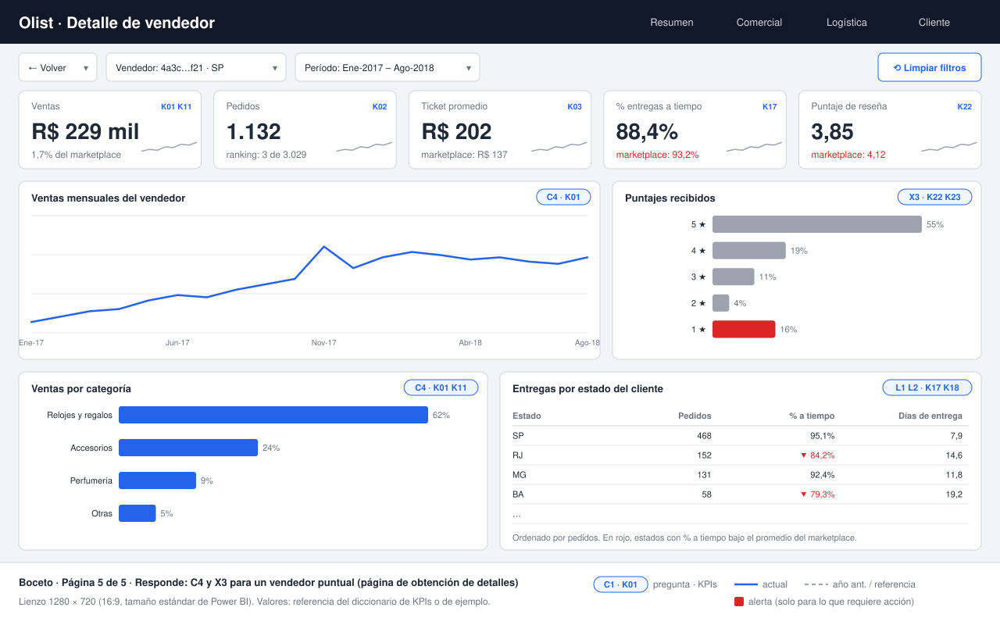

# Bocetos del tablero

Un boceto (*wireframe*) por cada página definida en [01_requerimientos.md](../01_requerimientos.md#6-páginas-del-tablero). Muestran **qué visual va en cada lugar, qué pregunta responde y con qué filtros**, antes de construir nada en Power BI. En la Fase 8 el reporte final se compara contra estos bocetos y contra los criterios de aceptación.

Para regenerarlos después de un cambio:

```bash
python docs/bocetos/generar_bocetos.py
```

### 1. Resumen ejecutivo · responde C1, L1, X1



### 2. Comercial · responde C1 a C5



### 3. Logística · responde L1 a L5



### 4. Cliente · responde X1 a X5



### 5. Detalle de vendedor · C4 y X3 para un vendedor (se llega por obtención de detalles)



Las etiquetas azules de cada visual (por ejemplo `C1 · K01 K07`) indican la pregunta de negocio que responde y los KPIs del [diccionario](../kpi_diccionario.md) que usa. Los valores son los de referencia o se calcularon de los datos reales; los de la página de vendedor son de ejemplo.

---

## Criterios de diseño

Son las reglas que siguen las 5 páginas. En la Fase 8 se implementan en un tema JSON de Power BI, así no dependen de acordarse de aplicarlas a mano.

### 1. Una estructura igual en todas las páginas

Todas tienen el mismo esqueleto, de arriba hacia abajo:

1. **Encabezado** con el título y la navegación entre páginas (la activa, resaltada).
2. **Barra de filtros**, siempre en el mismo orden: período, región, estado, categoría, y a la derecha **Limpiar filtros**.
3. **Fila de KPIs**: 5 o 6 tarjetas con el número del período, su variación y una mini tendencia.
4. **Dos filas de visuales** que responden las preguntas de la página.

El usuario aprende dónde está cada cosa una sola vez. Si en una página los filtros estuvieran a la izquierda y en otra arriba, cada cambio de página obligaría a buscarlos.

### 2. De lo general a lo particular (lectura en Z)

La vista recorre la página de izquierda a derecha y de arriba hacia abajo. Por eso:

- Arriba van **los números** (¿cómo estamos?).
- En el medio, **la evolución** (¿cómo llegamos acá?).
- Abajo, **el detalle** (¿dónde está el problema?: por estado, categoría, vendedor o ruta).

El visual más importante de cada página ocupa el lugar más grande y más arriba a la izquierda.

### 3. Grilla fija

- Lienzo de **1280 × 720** (16:9, el tamaño estándar de Power BI).
- Márgenes de **24 px** y separación de **16 px** entre visuales.
- Todas las tarjetas comparten bordes: las columnas se alinean entre filas.

Una grilla fija es lo que hace que un tablero se vea prolijo aunque nadie sepa decir por qué.

### 4. Pocos visuales por página

Entre 4 y 6 visuales, más la fila de KPIs. Cada visual responde al menos una pregunta de los requerimientos; **si un visual no tiene etiqueta de pregunta, sobra**. El resumen ejecutivo es el más austero porque tiene que entenderse en 10 segundos.

### 5. Cada pregunta, con el gráfico que mejor la responde

| Tipo de pregunta | Gráfico | Dónde |
|---|---|---|
| Evolución en el tiempo | Líneas (columnas si son volúmenes mensuales) | Ventas por mes, % a tiempo por mes |
| Comparar contra el año anterior | Dos líneas: actual sólida, anterior punteada | Resumen |
| Ranking | Barras horizontales ordenadas de mayor a menor | Categorías, vendedores, días por estado |
| Composición en el tiempo | Columnas apiladas al 100% | Distribución de puntajes por mes |
| Dos dimensiones a la vez | Matriz con mapa de calor | Rutas vendedor → cliente, cohortes |
| Comparar dos grupos | Dos columnas con el valor grande | Puntaje a tiempo contra tarde |
| Geografía | Mapa coroplético | Ventas por estado |

**Descartados a propósito:**
- **Tortas y anillos:** el ojo compara mal ángulos. Para participación se usan barras con el % al lado.
- **Medidores (gauges):** ocupan mucho lugar para mostrar un solo número; una tarjeta con su variación dice lo mismo.
- **Gráficos 3D:** deforman las proporciones.

**Sobre el mapa:** en el boceto se dibuja como mapa de mosaicos (un cuadrado igual por estado) porque en un mapa real Amazonas, enorme y con pocas ventas, se roba la atención (0,2% de las ventas) frente a São Paulo, chico y con el 38%. En Power BI se usa el mapa de formas (*Shape map*) o el coroplético, siempre acompañado del ranking o del tooltip con el valor exacto.

### 6. El color significa algo

- **Gris** es el estado normal. **Azul** resalta lo que hay que mirar (la serie actual, el primero del ranking, las regiones con más flete).
- **Rojo** solo para alertas que piden acción: demoras, reseñas negativas, un vendedor por debajo del promedio. Si todo fuera rojo, nada sería urgente.
- **Una sola rampa de azules** para los mapas de calor, de claro (menos) a oscuro (más).
- Los puntajes de 1 a 5 usan una escala **divergente**: rojos para 1 y 2, gris para 3, azules para 4 y 5.
- No se usa verde y rojo juntos como única diferencia (el daltonismo más común confunde esos dos). Las variaciones llevan además **▲ / ▼**.

### 7. Números legibles y con contexto

- Valores grandes **abreviados** (R$ 13,4 M, no 13.449.529,68). El detalle completo va en el tooltip.
- Formato argentino y brasileño: coma decimal y punto de miles.
- Cada número de una tarjeta va con su **contexto**: variación contra el año anterior, mediana o comparación con el marketplace. Un número solo no dice si está bien o mal.
- Las líneas de referencia (promedio, año anterior) van **punteadas y en gris**, para que no compitan con el dato.

### 8. Títulos que dicen qué se mira

Cada visual tiene un título que describe la medida y el corte ("Días promedio de entrega por estado del cliente"), no un nombre técnico ("Medida1 por customer_state"). Cuando hay un hallazgo, se anota debajo del visual (por ejemplo, el pico de Black Friday en noviembre de 2017).

### 9. Navegación e interacción

- **Botones de página** en el encabezado, en lugar de las pestañas de Power BI.
- **Obtención de detalles** (*drill-through*): clic derecho en un vendedor lleva a su página de detalle, que tiene un botón **← Volver**.
- **Filtros sincronizados**: si filtrás Nordeste en Comercial, Logística también muestra Nordeste.
- **Tooltips** con el detalle que no entra en el visual (ventas, pedidos y ticket de un estado).
- **Top N elegible** con un parámetro numérico, para que Comercial pueda ver los 5 o los 20 primeros vendedores.
